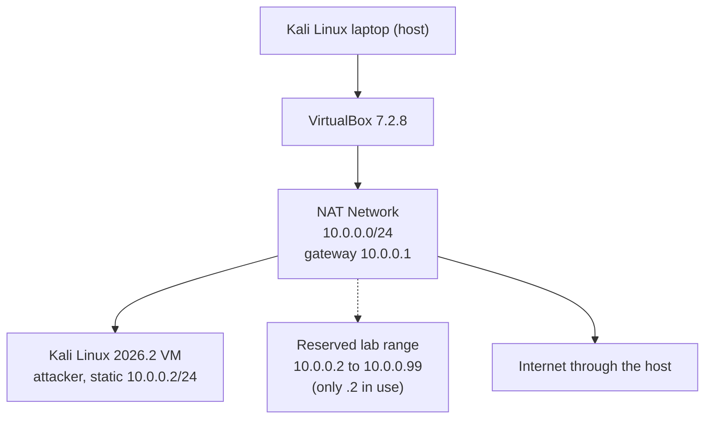

# Cybersecurity Home Lab: Kali Linux on a VirtualBox NAT Network


**Author:** Lawrence Geoffrey | **Program:** Networkwalks Cybersecurity internship | **Task:** WK1-PM1 | **Date:** 28 October 2026

An isolated cybersecurity lab. A Kali Linux virtual machine (the attacking machine) runs inside VirtualBox on my Kali Linux laptop, attached to a private NAT Network on `10.0.0.0/24`. Kali has the static address `10.0.0.2/24` and full Internet access, and the network has room for target machines later.

---

## Contents

1. [Objective](#objective)
2. [Requirements and evidence](#requirements-and-evidence)
3. [Lab architecture](#lab-architecture)
4. [Lab configuration](#lab-configuration)
5. [Setup walkthrough](#setup-walkthrough)
6. [Terminal verification](#terminal-verification)
7. [Findings and observations](#findings-and-observations)
8. [Troubleshooting reference](#troubleshooting-reference)
9. [Security considerations](#security-considerations)
10. [What I learned](#what-i-learned)
11. [Repository structure](#repository-structure)

---

## Objective

Build the lab environment set out in task WK1-PM1 and prove, with screenshots and terminal output, that every requirement is met:

- VirtualBox as the base
- Kali Linux as the attacking machine
- A NAT Network on 10.0.0.0/24
- Clipboard and drag/drop enabled, with the host Downloads folder shared
- Kali at 10.0.0.2/24 with full Internet access
- A snapshot as a recovery point

## Requirements and evidence

| # | Task requirement | Status | Evidence |
|---|---|---|---|
| 1 | VirtualBox as the base | Done (7.2.8) | [Screenshot 06](screenshots/06-virtualbox-version.png) |
| 2 | Kali Linux as the attacking machine | Done (2026.2) | [Screenshot 07](screenshots/07-kali-version.png) |
| 3 | Network in subnet 10.0.0.0/24 | Done | [Screenshot 01](screenshots/01-natnetwork.png), [route output](#2-routing-table) |
| 4 | NAT Network with 10.0.0.0/24 | Done | [Screenshot 01](screenshots/01-natnetwork.png), [Screenshot 02](screenshots/02-kali-adapter.png) |
| 5 | Clipboard and drag/drop enabled | Done | [Screenshot 03](screenshots/03-shared-folders.png) |
| 6 | Host Downloads folder shared | Done | [Screenshot 03](screenshots/03-shared-folders.png) |
| 7 | Kali IP address is 10.0.0.2/24 | Done | [Screenshot 04](screenshots/04-kali-ip.png), [terminal output](#1-ip-address) |
| 8 | Full Internet access | Done | [Connectivity tests](#3-to-5-connectivity) |
| 9 | Snapshot of the VM | Done | [Screenshot 05](screenshots/05-snapshot.png) |

## Lab architecture



Both the host and the VM are Kali Linux. The host is my daily machine, and the VM is the isolated lab.

## Lab configuration

| Component | Setting |
|---|---|
| Host | Kali Linux laptop |
| Hypervisor | VirtualBox 7.2.8 (Debian build) |
| Guest (attacker) | Kali GNU/Linux Rolling 2026.2, kernel 6.19.14+kali-amd64 |
| Virtual network | VirtualBox NAT Network, 10.0.0.0/24, DHCP enabled |
| Guest interface | `eth0` |
| Guest address | 10.0.0.2/24, set manually (static) |
| Default gateway | 10.0.0.1 |
| DNS server | 8.8.8.8 |
| Shared folder | Host Downloads folder |
| Clipboard and drag/drop | Enabled |

## Setup walkthrough

### 1. NAT Network
A NAT Network named in VirtualBox's network manager was created with the prefix 10.0.0.0/24 and DHCP enabled. Unlike plain NAT, every VM attached to a NAT Network sits on the same private subnet and can talk to the others, while still sharing the host's Internet connection.


### 2. Kali network adapter
The Kali VM's Adapter 1 was attached to the NAT Network instead of plain NAT, so the VM lives on the lab subnet.


### 3. Shared folder, clipboard and drag/drop
The host Downloads folder was shared with the VM, and the shared clipboard and drag/drop were enabled so files and text move easily between host and lab.


### 4. Static IP address
The VM's wired connection was set to a manual IPv4 address of 10.0.0.2/24 with gateway 10.0.0.1 and DNS 8.8.8.8.


### 5. Snapshot
Once everything was verified, I took a snapshot to give the lab a clean recovery point.


### 6. Versions


## Terminal verification

All output below was captured from inside the Kali VM on 28 October 2026.

### 1. IP address
```
$ ip -br addr
lo               UNKNOWN        127.0.0.1/8 ::1/128
eth0             UP             10.0.0.2/24 fe80::a00:27ff:fea9:758/64
```

### 2. Routing table
```
$ ip route
default via 10.0.0.1 dev eth0 proto static metric 100
10.0.0.0/24 dev eth0 proto kernel scope link src 10.0.0.2 metric 100
```

### 3 to 5. Connectivity
```
$ ping -c 3 10.0.0.1
64 bytes from 10.0.0.1: icmp_seq=1 ttl=64 time=0.231 ms
64 bytes from 10.0.0.1: icmp_seq=2 ttl=64 time=0.234 ms
64 bytes from 10.0.0.1: icmp_seq=3 ttl=64 time=0.215 ms
3 packets transmitted, 3 received, 0% packet loss

$ ping -c 3 8.8.8.8
64 bytes from 8.8.8.8: icmp_seq=1 ttl=64 time=253 ms
64 bytes from 8.8.8.8: icmp_seq=2 ttl=64 time=174 ms
64 bytes from 8.8.8.8: icmp_seq=3 ttl=64 time=106 ms
3 packets transmitted, 3 received, 0% packet loss

$ ping -c 3 google.com
64 bytes from ncmrsa-ao-in-f14.1e100.net (142.250.181.110): icmp_seq=2 ttl=64 time=364 ms
64 bytes from ncmrsa-ao-in-f14.1e100.net (142.250.181.110): icmp_seq=3 ttl=64 time=284 ms
3 packets transmitted, 2 received, 33.3333% packet loss
```

### 6. HTTPS
```
$ curl -sI https://www.kali.org
HTTP/2 200
content-type: text/html; charset=utf-8
server: cloudflare
(remaining headers trimmed)
```

### 7. Saved connection settings
```
$ nmcli -f ipv4.method,ipv4.addresses,ipv4.gateway,ipv4.dns connection show "Wired connection 1"
ipv4.method:     manual
ipv4.addresses:  10.0.0.2/24
ipv4.gateway:    10.0.0.1
ipv4.dns:        8.8.8.8
```

## Findings and observations

- **The gateway answers in under a millisecond** (about 0.2 ms), as expected for a virtual router on the same host.
- **Internet access works by IP and by name**, so routing and DNS are both functioning. `curl` returned `HTTP/2 200` from kali.org.
- **One packet was lost on the google.com test.** The first echo (`icmp_seq=1`) got no reply and the next two succeeded. The same test to 8.8.8.8 had no loss, so the likely cause is the first packet being sent while the name was still being resolved, but I have not confirmed that.
- **Replies from external hosts show `ttl=64`.** Internet hosts normally reply with a different starting TTL, so this suggests VirtualBox's NAT engine is answering the ping itself instead of passing the packet all the way through. This is my interpretation, not something I verified.
- **Latency to the Internet is high and variable** (106 to 364 ms), which comes from the upstream connection, not the lab.

## Troubleshooting reference

The course material lists a known issue where a Kali VM on VirtualBox 7 can lose Internet access after a static IP is set. If that happens, the fix it gives is:

```bash
sudo nmcli connection modify "Wired connection 1" ipv4.dad-timeout 0
sudo nmcli connection down "Wired connection 1"
sudo nmcli connection up "Wired connection 1"
```

Other checks, in order:
1. Confirm the NAT Network exists with the prefix 10.0.0.0/24.
2. Confirm the VM adapter is attached to that NAT Network.
3. Make sure no other VM on the same network uses 10.0.0.2.
4. If names do not resolve but pings to 8.8.8.8 work, try DNS 10.0.0.1.

A layered check helps find the failing step quickly: `ip -br addr`, then `ip route`, then ping the gateway, then an external IP, then a domain name.

## Security considerations

- **Isolation:** a NAT Network keeps the lab VMs off the host's local network. Only outbound traffic is translated, so nothing outside can reach the VMs unless port forwarding is added.
- **Shared folder:** it exposes a host folder to the VM. Share only what the lab needs, and be careful when running untrusted tools.
- **Snapshots:** take one before risky experiments and restore it if the VM is in doubt.
- **Ethical use:** this lab is for learning and authorised testing only. I test only systems I own or have written permission to test.

## What I learned

- A NAT Network differs from plain NAT: VMs on it share one private subnet, which suits a multi-machine lab.
- Having the right IP address is not enough. `ip route` shows whether a default route actually exists.
- Pinging in layers (gateway, external IP, domain name) narrows down where a connection fails.
- Saving real terminal output as evidence is stronger than a screenshot alone, and it can be re-run to prove the lab still works.
- A snapshot taken after verification is a dependable restore point.

## Repository structure

```
.
├── README.md
└── screenshots/
    ├── 01-natnetwork.png
    ├── 02-kali-adapter.png
    ├── 03-shared-folders.png
    ├── 04-kali-ip.png
    ├── 05-snapshot.png
    ├── 06-virtualbox-version.png
    └── 07-kali-version.png
```
