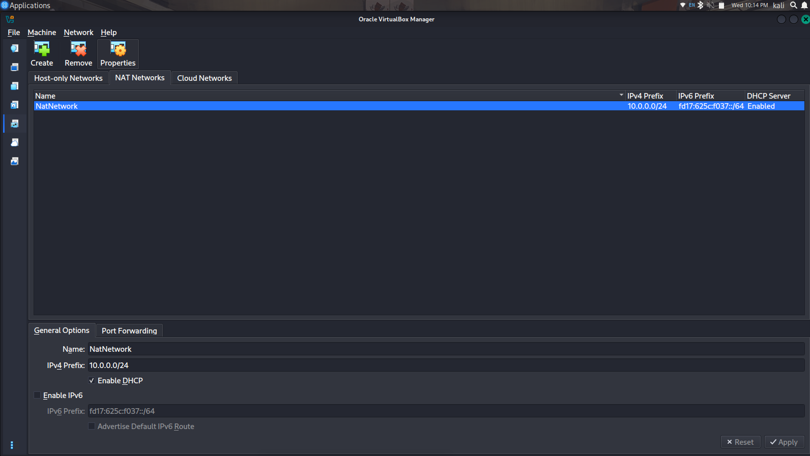
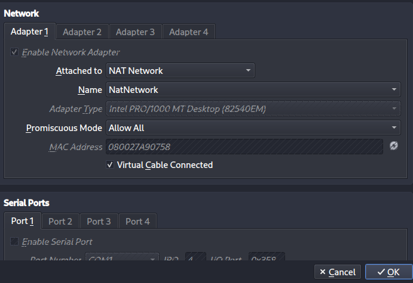
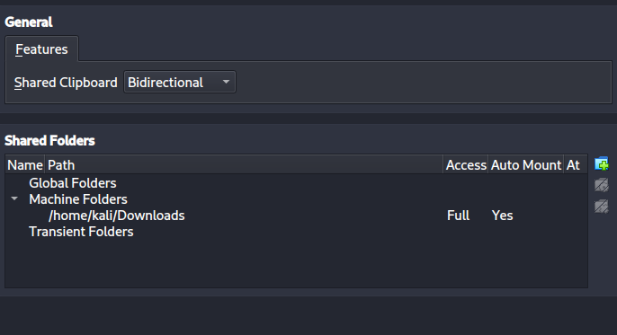
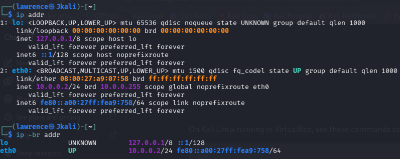
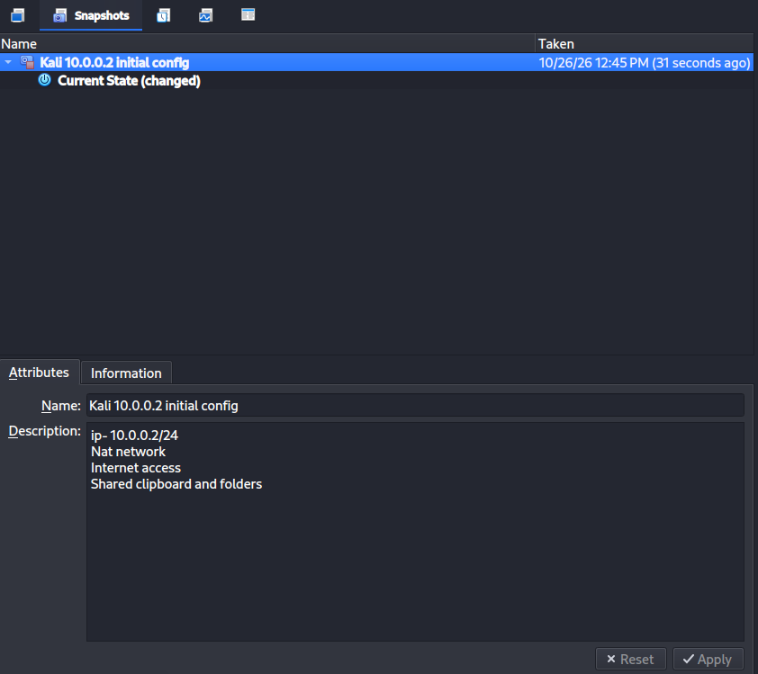
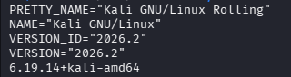

# Kali on a Private Network: Building and Proving My Cybersecurity Lab

**Lawrence Geoffrey** · Networkwalks internship · Task WK1-PM1 · 28 October 2026

I built an isolated attack lab: a Kali Linux virtual machine on its own private network, with a fixed address, full Internet access and a clean snapshot to return to. Then I checked every claim from the terminal instead of trusting the settings screens. This page is the whole record: what I built, why I built it that way, and the proof.

---

## Lab status

> **9 of 9 checks passed**
>
> - ✅ **VirtualBox as the base**: version 7.2.8 · [screenshot](screenshots/06-virtualbox-version.png)
> - ✅ **Kali Linux as the attacker**: Kali 2026.2 · [screenshot](screenshots/07-kali-version.png)
> - ✅ **Subnet 10.0.0.0/24**: `ip route` · [output](evidence/02-ip-route.txt) · [screenshot](screenshots/01-natnetwork.png)
> - ✅ **Runs on a NAT Network**: [network](screenshots/01-natnetwork.png) · [VM adapter](screenshots/02-kali-adapter.png)
> - ✅ **Clipboard and drag/drop enabled**: [screenshot](screenshots/03-shared-folders.png)
> - ✅ **Host Downloads folder shared**: [screenshot](screenshots/03-shared-folders.png)
> - ✅ **Kali is 10.0.0.2/24**: `ip -br addr` · [output](evidence/01-ip-address.txt) · [screenshot](screenshots/04-kali-ip.png)
> - ✅ **Full Internet access**: [gateway](evidence/03-ping-gateway.txt) · [8.8.8.8](evidence/04-ping-internet.txt) · [DNS](evidence/05-ping-dns.txt) · [HTTPS](evidence/06-https-check.txt)
> - ✅ **Snapshot taken**: [screenshot](screenshots/05-snapshot.png)

---

## The shape of it

```
┌─────────────────────────────────────────────────────┐
│ HOST: Kali Linux laptop                             │
│                                                     │
│ ┌─────────────────────────────────────────────────┐ │
│ │ VirtualBox 7.2.8                                │ │
│ │                                                 │ │
│ │ NAT Network 10.0.0.0/24                         │ │
│ │ gateway 10.0.0.1                                │ │
│ │                                                 │ │
│ │ ┌───────────────────┐  ┌──────────────────────┐ │ │
│ │ │ Kali 2026.2 VM    │  │ unused address space │ │ │
│ │ │ 10.0.0.2/24       │  │ empty today          │ │ │
│ │ │ the attacker      │  │                      │ │ │
│ │ └───────────────────┘  └──────────────────────┘ │ │
│ └─────────────────────────────────────────────────┘ │
└─────────────────────────────────────────────────────┘
                           │
                           ▼
             Internet (via the host)
```

There are two Kalis in this project, and that is deliberate. My laptop runs Kali as the host machine. The lab is a second Kali inside VirtualBox. The host is where I write and document; the VM is where the lab lives and where anything risky will happen. I push to GitHub from a host machine, so no GitHub credentials ever sit inside the attack VM.

---

## Lab notebook

### Entry 1: A private network for the lab
I created a VirtualBox **NAT Network** on `10.0.0.0/24`. I chose a NAT Network over plain NAT on purpose. With plain NAT every VM is isolated from the others, so machines in a lab cannot talk to each other. A NAT Network puts all attached VMs on one private subnet while they still share the host's Internet connection, and nothing from outside can start a connection into it.



### Entry 2: Putting Kali on that network
The Kali VM's Adapter 1 is attached to the NAT Network, not to plain NAT. Without that step the VM would sit on a different subnet and none of the later address work would matter.



### Entry 3: Moving files and text between host and lab
Clipboard and drag/drop are set to bidirectional, and the host's Downloads folder is shared into the VM, as the task requires. This is the convenience channel between the two machines. It is also the one place where the lab touches the host's files, so I treat it with care (see "Why it's built this way" below).



### Entry 4: A fixed address for the attacker
I set Kali's connection to **manual** with the address `10.0.0.2/24`, gateway `10.0.0.1` and DNS `8.8.8.8`. I wanted a fixed address so that notes, scans and any future targets always point at one known place. The saved configuration confirms it:

```
$ nmcli -f ipv4.method,ipv4.addresses,ipv4.gateway,ipv4.dns connection show "Wired connection 1"
ipv4.method:                            manual
ipv4.addresses:                         10.0.0.2/24
ipv4.gateway:                           10.0.0.1
ipv4.dns:                               8.8.8.8
```

Raw output: [evidence/07-nmcli-config.txt](evidence/07-nmcli-config.txt)



### Entry 5: Proving it from the terminal
Settings screens only say what I asked for. These commands say what the machine is actually doing. Everything below was captured inside the VM on 28 October 2026 at 23:21 (WAT); the raw files are in [`evidence/`](evidence/).

**What address do I hold?**
```
$ ip -br addr
lo               UNKNOWN        127.0.0.1/8 ::1/128
eth0             UP             10.0.0.2/24 fe80::a00:27ff:fea9:758/64
```

**Where does my traffic go?**
```
$ ip route
default via 10.0.0.1 dev eth0 proto static metric 100
10.0.0.0/24 dev eth0 proto kernel scope link src 10.0.0.2 metric 100
```
Having the right address is only half of it. This output shows the other half: a default route through `10.0.0.1`.

**Can I reach the gateway, the Internet by number, and the Internet by name?**
```
$ ping -c 3 10.0.0.1
64 bytes from 10.0.0.1: icmp_seq=1 ttl=64 time=0.231 ms
64 bytes from 10.0.0.1: icmp_seq=2 ttl=64 time=0.234 ms
64 bytes from 10.0.0.1: icmp_seq=3 ttl=64 time=0.215 ms
3 packets transmitted, 3 received, 0% packet loss

$ ping -c 3 8.8.8.8
64 bytes from 8.8.8.8: icmp_seq=1 ttl=64 time=253 ms
64 bytes from 8.8.8.8: icmp_seq=2 ttl=64 time=174 ms
64 bytes from 8.8.8.8: icmp_seq=3 ttl=64 time=106 ms
3 packets transmitted, 3 received, 0% packet loss

$ ping -c 3 google.com
64 bytes from ncmrsa-ao-in-f14.1e100.net (142.250.181.110): icmp_seq=2 ttl=64 time=364 ms
64 bytes from ncmrsa-ao-in-f14.1e100.net (142.250.181.110): icmp_seq=3 ttl=64 time=284 ms
3 packets transmitted, 2 received, 33.3333% packet loss
```

**Does a real HTTPS request work?**
```
$ curl -sI https://www.kali.org
HTTP/2 200
content-type: text/html; charset=utf-8
server: cloudflare
(remaining headers trimmed)
```

The order matters. Gateway first, then an IP address, then a name, then HTTPS. Each step proves one more layer, so if something fails I know which layer to look at.

### Entry 6: The recovery point
With everything verified, I took a snapshot. A snapshot taken after the checks pass is a known-good state I can return to after any experiment goes wrong.



### Entry 7: Recording the versions




| Component | Version |
|---|---|
| VirtualBox | 7.2.8 (Debian build) |
| Kali (VM) | 2026.2, kernel 6.19.14+kali-amd64 |

---

## What the output shows, and what I can't fully explain yet

I'd rather record the odd results than hide them.

- **The gateway replies in about 0.2 ms.** That fits a virtual router running on the same machine.
- **The google.com test lost a packet.** The first echo got no reply and the next two did, while the same test to `8.8.8.8` was clean. `ping` resolves the name before it sends anything, so a DNS delay does not explain it. I have not yet repeated the test with more packets to see whether the loss recurs, and I have not found the cause.
- **Replies from the Internet show `ttl=64`.** A real server far away would normally reply with a different TTL. My reading is that VirtualBox's NAT is answering the ping itself instead of passing it through. This is my interpretation and I have not verified it.
- **Latency is high and uneven** (106 to 364 ms). That points at the upstream connection, not the lab, since the gateway answers instantly.

---

## If it breaks: how I'd debug it

I work from the bottom up and stop at the first thing that fails:

1. `ip -br addr`: is `eth0` up, with `10.0.0.2/24`?
2. `ip route`: is there a default route via `10.0.0.1`?
3. `ping -c 3 10.0.0.1`: does the gateway answer?
4. `ping -c 3 8.8.8.8`: does traffic leave the network?
5. `ping -c 3 google.com`: does DNS work? If 8.8.8.8 works but names fail, try DNS `10.0.0.1`.
6. Check in VirtualBox that the NAT Network exists, the adapter is attached to it, and no other VM on that network uses `10.0.0.2`.

The course material also lists a known fix for Internet loss after setting a static IP on VirtualBox 7 with newer Kali, which I keep in reserve:

```bash
sudo nmcli connection modify "Wired connection 1" ipv4.dad-timeout 0
sudo nmcli connection down "Wired connection 1"
sudo nmcli connection up "Wired connection 1"
```

---

## Why it's built this way

- **Isolation.** The NAT Network keeps lab machines off my home network. Traffic can leave, but nothing outside can start a connection in.
- **Disposable attacker.** The attack machine is a VM with a snapshot, so a mistake costs a restore, not a rebuild.
- **Credentials stay out of the lab.** I push to GitHub from a host machine, never from the attack VM.
- **Shared folder scope.** The task shares the host's Downloads folder, which means anything running in the VM can read it. In a real engagement I would share a dedicated `lab-share` folder, read-only where possible.
- **Authorised targets only.** This lab is for learning. I test only systems I own or have written permission to test.

---

## The same lab from the terminal (reference)

These are the equivalent VirtualBox command-line steps, listed for reproducibility. They are reference commands, not a record of what I typed.

```bash
# On the host: create the NAT Network (use your own network name)
VBoxManage natnetwork add --netname NatNetwork --network "10.0.0.0/24" --enable --dhcp on

# On the host: attach the VM to it (use your own VM name)
VBoxManage modifyvm "<VM name>" --nic1 natnetwork --nat-network1 NatNetwork

# Inside the VM: static address
sudo nmcli connection modify "Wired connection 1" \
  ipv4.method manual ipv4.addresses 10.0.0.2/24 \
  ipv4.gateway 10.0.0.1 ipv4.dns 8.8.8.8
sudo nmcli connection down "Wired connection 1"
sudo nmcli connection up "Wired connection 1"

# Inside the VM: re-run all the proof in one go
./scripts/verify-lab.sh
```

---

## What I'm taking away

- A NAT Network is the right shape for a multi-machine lab: one private subnet, shared Internet, no way in from outside.
- A correct IP address does not guarantee a working connection. `ip route` shows whether traffic actually has somewhere to go.
- Testing in layers (gateway, IP, name, HTTPS) turns "it doesn't work" into "this layer doesn't work".
- Evidence beats assertion. Saved terminal output with a timestamp is stronger than a settings screenshot, and a script makes it repeatable.
- Odd results are worth writing down. The packet loss and the `ttl=64` replies taught me more than the clean tests did.

---

## Repo map

```
.
├── README.md
├── screenshots/    seven screenshots, numbered in build order
├── evidence/       raw terminal output from inside the VM
└── scripts/
    └── verify-lab.sh    re-runs every check and saves the output
```